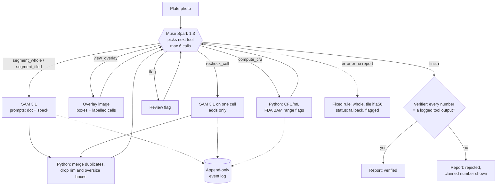

# PlateCount

**Photograph an agar plate and get a colony count and a CFU/mL estimate. An agent checks the segmentation, and a verifier rejects any number that no tool produced.**

**Live demo:** https://platecount-i9lt.onrender.com
(It runs on a free host that sleeps when idle, so the first load can take about a minute. Three demo plates run at no cost. You can also upload your own photo.)

## Built during the hackathon

All code in this repository was written during the Meta Global AI Developer Hackathon, Nov 1-4, 2026.
Code from a pilot made before the event was not reused. [PROGRESS.md](PROGRESS.md) is the dated build log:

- **Nov 1:** SAM 3.1 client and prompt tests, CFU math, AGAR split, tiling
- **Nov 2:** counting rule, Spark agent, verifier, event log, held-out test run, FastAPI app and mobile page
- **Nov 3:** deploy and README
- **Nov 4:** video and submission

## The problem

Microbiology labs still count colonies on agar plates by eye. A tech counts each plate with a pen and a
clicker, then converts the count to CFU/mL by hand. On a busy day that means hundreds of plates.
The work is slow and tiring, and two people often get different counts for the same plate.
Simple "count the blobs" tools give you one number and no way to check it: you can't tell whether
they missed half the plate or counted glare.

PlateCount shows how it got each count. It records every step, shows an outline overlay, and refuses
to report a number it can't trace to a tool output. It also flags plates a person should look at.
It reports a lab measurement for a person to review. It gives no medical or food-safety advice.

## How it works

1. **SAM 3.1 finds the colonies.** The prompt "colony" returns 0 instances, and so do "bacterial colony",
   "bacteria" and "circle". "dot" and "speck" find colonies, so SAM gets both prompts and code merges the
   duplicate boxes ([prompt tests](PROGRESS.md), [API notes](docs/meta-api.md)).
2. **A Muse Spark 1.3 agent decides the next step**, using these tools:
   - `segment_whole` or `segment_tiled`: segment the whole image, or 9 overlapping tiles. Tiling helps
     on dense plates but adds specks on sparse ones.
   - `view_overlay`: the agent looks at the photo with every box outlined and names the cells where it
     sees missed or merged colonies.
   - `recheck_cell`: SAM looks again at one cell. This can only add colonies, never remove them.
   - `flag`: marks the plate for review (spreader, too many to count, low confidence).
   - `compute_cfu` and `finish`.
3. **Code does all the arithmetic.** The agent never counts or calculates. Counts come from SAM boxes
   and Python code. CFU/mL = colonies / (dilution × mL plated), and exact fractions keep float noise out.
   Plates outside the FDA BAM Ch. 3 countable range (15-300 colonies) are still reported, with a flag.
4. **The verifier checks the report.** Every number in it must equal a logged tool output, and there
   must have been a real segmentation. Otherwise the report is rejected and the rejected number is
   shown. If the agent can't produce a report at all (API error, step limit), PlateCount falls back to a
   fixed rule: whole image first, tiled if 56 or more colonies are found. The fallback is flagged.
5. **An event log records each run.** It is append-only and holds every tool call with its input hash,
   output and cost.



## Results

The benchmark uses [AGAR](https://agar.neurosys.com) plates with known colony counts. The 39-plate
sample was split once with a fixed seed and the split committed before any benchmark call:
16 dev plates and 23 held-out test plates. The test split ran **once**, at tag `eval-v1`.
Full table: [results/test_eval_v1.md](results/test_eval_v1.md).

The comparison is the agent against the fixed rule ("policy": whole image, tiled at 56 or more),
which was tuned on the dev plates.

| 23 test plates | Agent [95% CI] | Fixed rule [95% CI] | Agent minus rule [95% CI] |
|---|---|---|---|
| Mean absolute error (colonies) | **3.78** [2.04, 5.78] | 5.57 [2.43, 9.30] | -1.78 [-5.17, 0.91] |
| sMAPE | **8.7%** [5.0, 13.3] | 11.1% [5.9, 17.1] | -2.5% [-7.0, 0.9] |
| Plates within 10% of truth | **73.9%** [56.5, 91.3] | 69.6% [52.2, 87.0] | +4.3% [-8.7, 17.4] |
| Box precision / recall | 0.90 / 0.91 | 0.85 / 0.90 | |
| Verified reports | 23 of 23 | n/a | |

The CIs are 95% paired percentile bootstraps: 10,000 resamples over the plates, seed 20261102.
The test run cost $1.02 in total, about $0.03 per plate for the agent.

**Limits:**
- **23 plates is a small sample.** All three paired intervals include 0, so the agent is **not
  significantly better** than the fixed rule. The data are consistent with a real gain and with no gain.
  Most of the gap comes from 2 of the 4 plates where the two disagree (11924 and 734). On a third (525)
  the agent did worse.
- **The test plates are sparse to medium (4-130 colonies), with none above 150**, so the test split
  says nothing about dense plates. The only dense plate we have is dev plate 518: tiling counts
  **256 against a true 298**, up from 63 on the whole image.
- **"Verified" means traceable, not correct.** Plate 971 passed verification and was still 16 colonies too high.
- AGAR records no dilution, so only counts are scored. The CFU/mL on demo plates uses assumed
  demo values (10^-2, 1 mL), and the page says so.

## Which Meta model does what

| Model | Job |
|---|---|
| **SAM 3.1** (`sam-3.1`) | All segmentation: whole image, 9 tiles, and single-cell rechecks, with text prompts "dot" and "speck". |
| **Muse Spark 1.3** (`muse-spark-1.3`, standard tier) | The agent: picks tools, looks at the overlay image, decides whether to tile, recheck or flag. It never counts or calculates. |

Both models are called through one HTTP client with a disk cache, retries and a running cost counter
(`src/platecount/meta/client.py`). The contributor tier, which allows training on inputs, is never used.

## Run it

Python 3.10+.

```bash
python -m venv .venv
source .venv/bin/activate          # Windows: .venv\Scripts\activate
pip install -r requirements.txt
echo "MODEL_API_KEY=your-key-from-dev.meta.ai" > .env
python -m pytest -q                 # no network: tests replay recorded API responses
uvicorn platecount.api.app:app --reload --app-dir src
```

Open http://localhost:8000. Optional environment variables: `DAILY_USD` (spend cap for the app, default 3),
`TRUST_PROXY=1` (behind a proxy that sets `CF-Connecting-IP` or `X-Forwarded-For`).

### Reproduce the benchmark

1. Download AGAR from https://agar.neurosys.com (CC BY-NC 2.0; it is not in this repo). Put the
   representative subset's `.jpg` and `.json` pairs in `data/agar_sample/AGAR_representative/`.
2. The split is frozen in `bench/split.json`. `python -m bench.split` won't overwrite it.
3. Run the dev split. Each run prints its cost and stops if spend goes over $5:
   ```bash
   python -m bench.run --split dev --limit 16 --variant policy
   python -m bench.run --split dev --limit 16 --variant agent
   ```
   Other variants: `whole`, `tiled`, `both`.
4. The test split is locked: `--split` accepts only `dev`. To repeat the held-out run, check out
   `eval-v1` and apply the one-line change listed in [results/test_eval_v1.md](results/test_eval_v1.md).
   That file also has the bootstrap script, which makes no API calls.

## Privacy

- Uploaded photos are sent to Meta's API (standard tier) for counting. The page tells visitors this before upload.
- Photos are kept in memory and in a per-request temp folder that is deleted when the request ends. They are
  never logged and never added to any dataset.
- `store: false` is sent on every Meta API call.
- The demo plates are served as counts and boxes from cache. No AGAR images are committed.

## Credits

- **AGAR dataset:** Majchrowska et al., [AGAR, a microbial colony dataset](https://agar.neurosys.com),
  NeuroSYS, licensed **CC BY-NC 2.0**. It is used here for non-commercial benchmarking only, and no AGAR
  files are in this repository.
- Counting rules follow the FDA *Bacteriological Analytical Manual*, Chapter 3 (revised March 2025).
- **Built with [Claude Code](https://claude.com/claude-code).** The project rules (`CLAUDE.md`), plan,
  subagents and skills are in `.claude/`.
